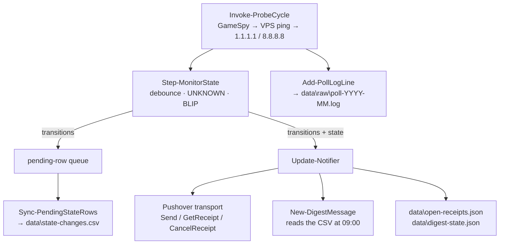

# 🗺️ UT99 Server Down Monitor — Workspace Map

> [!NOTE]
> **What this is**
> A **PowerShell 7** watchdog that runs as a scheduled task on the home PC. Every 30 s it probes the UT99 server
> (GameSpy UDP query, then ICMP), classifies the result, writes an append-only evidence CSV, and sends
> **Pushover** notifications. One module (`src\UT99Monitor.psm1`) with three thin entry scripts.

Files and what they are: see the **Key Files** table in `CLAUDE.md`. Usage, setup and notifications: `Readme.md`.
Requirements: the design spec in `docs\superpowers\specs\`.

> [!WARNING]
> `config.ini` holds the Pushover keys (untracked). `data\` is the outage evidence for NFOservers: untracked,
> append-only, synced off the PC by Dropbox. Never edit or commit either.

---

## 🧩 Module Map — `src\`

`UT99Monitor.psm1` dot-sources every `src\*.ps1` and exports all functions. Every decision function takes an
injected `-Now`; probes and the Pushover transport are injectable for tests.

| File | Responsibility | Key symbols |
|---|---|---|
| `Config.ps1` | INI parsing, defaults, validation | `Read-MonitorConfig`, `Read-IniFile`, `$script:ConfigDefaults` |
| `GameSpy.ps1` | `\status\` query, multi-packet reassembly per query id | `Invoke-GameSpyStatus`, `ConvertFrom-GameSpyPackets` |
| `Probes.ps1` | ICMP; one cycle → `UP/GAME_DOWN/HOST_DOWN/LINK_DOWN` | `Invoke-ProbeCycle`, `Test-IcmpEcho` |
| `StateMachine.ps1` | Debounce, UNKNOWN blind windows, class changes, BLIP | `New-MonitorState`, `Step-MonitorState`, `New-Transition` |
| `Evidence.ps1` | CSV and poll-log I/O, gap inference, pruning, file-lock retry | `Add-StateChangeRow`, `Sync-PendingStateRows`, `Read-StateChanges`, `Start-MonitorSession`, `Add-PollLogLine`, `Invoke-WithFileRetry` |
| `QuietHours.ps1` | Local wall-clock window, crosses midnight, DST-safe | `Test-InQuietHours`, `Get-QuietWindow` |
| `Intervals.ps1` | Rows → intervals → outages; report text | `Get-StateIntervals`, `Get-Outages`, `Get-DowntimeSummary`, `Format-DowntimeReport`, `Format-Duration` |
| `Digest.ps1` | 09:00 digest; persisted sent-state | `Test-DigestDue`, `Set-DigestSent`, `New-DigestMessage` |
| `Pushover.ps1` | HTTP transport object (`Send`, `GetReceipt`, `CancelReceipt` script methods) | `New-PushoverTransport`, `Invoke-PushoverSend`, `Get-PushoverFailure` |
| `Notifier.ps1` | Which message when; escalation; quiet-hours cancel; retries | `Update-Notifier`, `New-Notifier`, `Send-StartupNotice`, `Stop-Escalation`, `Invoke-CancelRetries`, `Save-OpenReceipts` |
| `Health.ps1` | Optional per-cycle dead-man's-switch ping (deferred feature) | `Invoke-CycleHook` |

Entry scripts: `UT99-Monitor.ps1` (main loop, mutex `Local\UT99ServerDownMonitor`), `Get-DowntimeReport.ps1`
(wraps `Format-DowntimeReport`), `Setup.ps1` (`Invoke-Setup`, `Write-ConfigWithKeys`, `New-MonitorTaskDefinition`;
dot-sourcing it loads the helpers without running setup).

### One cycle



Order matters: the evidence write comes before notifications, and `Update-Notifier` runs even if the CSV write
failed. Rows that couldn't be written stay queued and are written in order on a later cycle.

---

## 🗃️ Data Stores — `data\`

| File | Written by | Note |
|---|---|---|
| `state-changes.csv` | `Add-StateChangeRow` | The evidence. Append-only; `Test-EndsWithNewline` repairs a power-cut tail before appending |
| `raw\poll-YYYY-MM.log` | `Add-PollLogLine` | One tab-separated line per cycle; pruned by `Remove-ExpiredPollLogs` after `RawRetentionMonths` |
| `monitor.log` | `Write-MonitorLog` | Starts, `SEND ok/FAIL`, `CANCEL`, `CYCLE_ERROR`, `ALREADY_RUNNING`, `CSV_WRITE_*` |
| `digest-state.json` | `Set-DigestSent` | `lastSentLocalDate`; tmp file + move |
| `open-receipts.json` | `Save-OpenReceipts` | Emergency receipts that may still be repeating; `Get-OrphanReceipts` cancels them after a restart |

### CSV schema

```text
timestamp_local,timestamp_utc,new_state,previous_state,previous_duration_seconds,map,numplayers,maxplayers,notes
2026-11-23T15:10:02-06:00,2026-11-23T21:10:02Z,UP,MONITOR_STARTED,0,DM-Codex,0,14,
```

- `new_state`: `UP`, `GAME_DOWN`, `HOST_DOWN`, `UNKNOWN` (notes `cause=LINK_DOWN`), `BLIP`, `MONITOR_STARTED`,
  `MONITOR_STOPPED`, `MONITOR_GAP`.
- **BLIP is an event, not a state.** Its `previous_duration_seconds` is empty, and `Get-StateIntervals` skips it.
- A down row is timestamped at the **first failing** cycle and an UP row at the **first successful** one, so
  rows are written up to ~60 s after their timestamp. Timestamps stay monotonic because a LINK_DOWN clears the
  pending run starts.
- `MONITOR_GAP` is timestamped at the last poll-log line before the monitor died (`Get-LastPollTime`).

Poll-log line: `<ts>\t<class>\tgame=ok:Nms|fail:<err>\thost=ok:Nms|fail|skip\tlink=<target>:ok:Nms,…|skip\tmap=\tplayers=n/max\tqid=N`.
`qid` is the server's GameSpy query counter, which counts every query from anyone. It is logged for the planned
restart detection (open item).

---

## 🌐 External Pieces

| Piece | Where | Note |
|---|---|---|
| Scheduled task | `UT99 Server Down Monitor` | Created by `New-MonitorTaskDefinition`: at logon plus every 5 min, `IgnoreNew`, runs as the logged-on user (Interactive, never SYSTEM), `pwsh -WindowStyle Hidden -File UT99-Monitor.ps1`. Autologon makes it start unattended after a reboot |
| Target server | `74.91.119.21`, UDP 7778 (query), ICMP | NFOservers VPS; game port 7777 |
| Link probes | `1.1.1.1`, `8.8.8.8` | `LinkTargets` in config |
| Pushover API | `https://api.pushover.net/1/` | `messages.json`, `receipts/<id>.json`, `receipts/<id>/cancel.json`; message 1024 / title 250 char limits enforced in `Invoke-PushoverSend` |
| Secrets | `config.ini` `[Pushover]` | Written only by `Setup.ps1`; the transport keeps keys in `$script:PushoverSecrets`, never on the object |
| Tests | `tests\` | Pester 5+ (Pester 6 installed CurrentUser); `Invoke-Pester -Path tests -CI` |

---

## 🌿 Git

**Remote:** none yet (intended private GitHub repo). **Workflow:** feature branch → tests → commit → restart
the live monitor → live check → docs → merge to `main`. `data\`, `.superpowers\` and `testResults.xml` are
git-ignored; `*.ini` is excluded globally.

Start reading code history from these, then use `git log`:

| Commit | Change |
|---|---|
| `8421059` | Final-review fixes: blind-window escalation, CSV tail repair, cancel retry, receipt persistence, row queue, watchdog trigger |
| `0a6ba2f` | Main loop `UT99-Monitor.ps1` |
| `01131a1` | Notifier (escalation, quiet hours, digest, retry) |
| `8c48435` | State machine |
| `d4e82a6` | Design document and seed `MEMORY.md` |

---

## 🛠️ Working Notes

- **Run:** the scheduled task runs the monitor. To test changes, commit, then restart the task. `UT99-Monitor.ps1 -MaxCycles N -Probe … -Transport … -MutexName …` is for tests only.
- **Line endings:** CRLF on disk, LF in the repo (`core.autocrlf=true`).
- **PowerShell gotchas met here:** Set-StrictMode is on in the module (so `Measure-Object` on an empty input has no `.Sum`).
  Functions return arrays by enumerating, not with `, $array`. Single-letter test helpers can collide with
  aliases (`h`, `r`). `-like` is case-insensitive (use `-clike`).

### Common jumping-off points

| I want to… | Go to |
|---|---|
| Change how a cycle is classified | `Invoke-ProbeCycle`, `Invoke-GameSpyStatus` |
| Change debounce, blips or blind-window rules | `Step-MonitorState` |
| Change alert text, priorities or escalation | `New-DownMessage`, `Update-Notifier`, `Stop-Escalation` |
| Change quiet hours or the digest | `Test-InQuietHours`, `Get-QuietWindow`, `New-DigestMessage`, `Test-DigestDue` |
| Change what the report counts | `Get-StateIntervals`, `Get-Outages`, `Get-DowntimeSummary`, `Format-DowntimeReport` |
| Change the CSV or poll-log format | `Add-StateChangeRow`, `Read-StateChanges`, `Add-PollLogLine` |
| Add a setting | `$script:ConfigDefaults` and `Read-MonitorConfig`, plus `config.template` |
| Change the scheduled task | `New-MonitorTaskDefinition` |

Search for the name rather than scrolling. Function names are unique across `src\` and the scripts.
